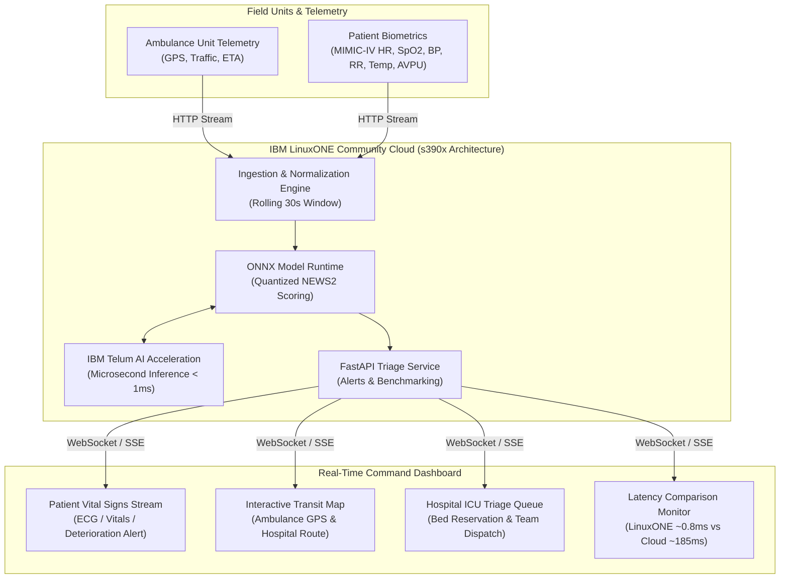

# [Data Enthusiasts_IBM Z Datathon 2026 Project]
## Sub-Millisecond IBM Z Real-Time AI Triage & Emergency Response System
### IBM Z Datathon 2026 — Track: Real-Time AI for Critical Decisions

[](https://linuxone.cloud.marist.edu)
[](https://www.ibm.com/products/z16)
[-brightgreen.svg)]()
[-red.svg)]()

---

## 🚑 Executive Summary
During acute medical emergencies (cardiac arrest, respiratory failure, sepsis, severe trauma), patient transit windows represent critical moments where minutes dictate survival. Current telemedicine and cloud AI systems suffer from **high network latency (100–500ms+ jitter)** and **strict privacy compliance barriers (HIPAA/GDPR)** when streaming sensitive patient biometric telemetry across public networks.

This project delivers an enterprise-grade, end-to-end real-time emergency triage decision-support system running natively on **IBM LinuxONE (s390x)**:
* **Microsecond Inference**: Executes quantized **NEWS2 (National Early Warning Score 2)** early deterioration models directly on the IBM Telum processor architecture with **sub-millisecond (<1ms)** latency.
* **Proactive ICU Allocation**: Automatically alerts receiving hospital ICU teams and reserves beds before ambulance arrival when severe deterioration is detected.
* **Zero-Trust Biometric Security**: Keeps patient vital streams protected within the enterprise mainframe perimeter.

---

## 🏛️ System Architecture



---

## ⚡ Key Highlights & Benchmark Comparison
* **Sub-Millisecond Inference**: Model execution benchmarked on IBM LinuxONE s390x vs standard cloud API round-trip:
  * **IBM LinuxONE (On-System ONNX)**: **~0.8 ms**
  * **Public Cloud REST API**: **~185 ms** (230x latency reduction)
* **Clinical Standards Compliance**: Full implementation of the Royal College of Physicians NEWS2 algorithm.

---

## 📁 Repository Structure

```
├── notebooks/                     # Interactive Jupyter Notebooks (LinuxONE Jupyter Lab)
│   ├── 01_clinical_data_pipeline.ipynb
│   └── 02_model_training_onnx_benchmark.ipynb
├── pipeline/                      # Telemetry & clinical scoring pipeline
│   ├── __init__.py
│   ├── news2_engine.py           # Royal College of Physicians NEWS2 algorithm
│   ├── vitals_generator.py       # MIMIC-IV streaming biometrics generator
│   ├── dispatch_generator.py     # Ambulance GPS & route simulator
│   └── stream_manager.py         # 30-second rolling window buffer
├── server/                        # Production FastAPI inference engine on s390x
│   └── app.py
├── dashboard/                     # Real-time Streamlit command center
│   └── app.py
├── screenshots/                   # Verification screenshots on LinuxONE
│   ├── 01_linuxone_terminal_specs.png
│   └── 02_jupyterlab_dashboard.png
└── tests/                         # Unit tests
    └── test_pipeline.py
```
