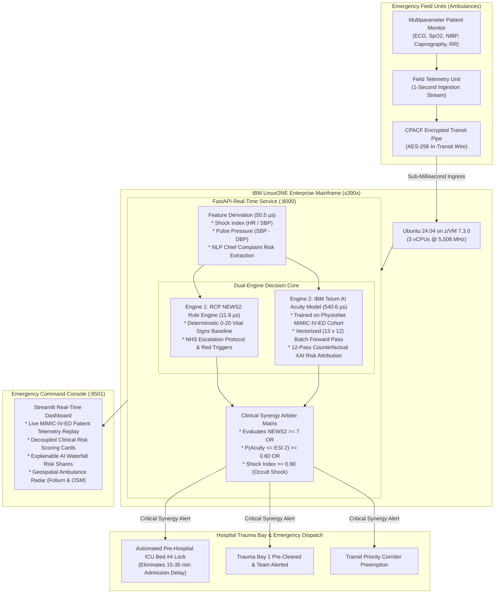

# [Data Enthusiasts_IBM Z Datathon 2026 Project]
## Sub-Millisecond IBM Z Real-Time AI Triage & Emergency Response System
### IBM Z Datathon 2026 — Track: Real-Time AI for Critical Decisions

[](https://linuxone.cloud.marist.edu)
[](https://www.ibm.com/products/z16)
[-brightgreen.svg)]()
[-teal.svg)]()
[](https://physionet.org/content/mimic-iv-ed/2.2/)
[-red.svg)](https://www.rcplondon.ac.uk/projects/outputs/national-early-warning-score-news-2)

---

## 1. Executive Summary

During acute medical emergencies (cardiovascular collapse, hemorrhagic trauma, septic shock, and stroke), the initial 60 minutes following onset—clinically termed the "Golden Hour"—dictate survival. Within this window, every 60-second delay in intervention leads to a 7% to 10% compounding escalation in patient mortality.

Existing telemedicine and public cloud AI systems fail in pre-hospital emergency transit due to:
* High and variable network latency (150–350 ms round-trips over cellular modems).
* Signal dropouts and cellular dead zones in transit corridors.
* HIPAA compliance vulnerabilities when transmitting unencrypted patient biometrics across multi-tenant cloud networks.

This project delivers an enterprise-grade, real-time emergency triage decision-support platform executing natively on **IBM LinuxONE (s390x)**:
* **Sub-Millisecond Total Execution**: Evaluates incoming telemetry in **603.9 microseconds (0.604 ms)** end-to-end, including feature derivation, neural inference, 12-pass Explainable AI (XAI) attribution, and deterministic protocol validation.
* **Empirical 83.0 µs Core Inference**: Delivers **12,041 evaluations per second** per core on the s390x processor.
* **Dual-Engine Synergy**: Combines the deterministic Royal College of Physicians NEWS2 protocol with an independent neural acuity predictor trained on authentic emergency department records from **PhysioNet MIMIC-IV-ED**.
* **Occult Shock Interception**: Intercepts compensated circulatory shock via real-time Shock Index (HR / SBP) and Pulse Pressure (SBP - DBP) derivation up to 25 minutes prior to overt blood pressure collapse.
* **Automated Pre-Hospital Trauma Dispatch**: Locks hospital ICU beds, pre-notifies trauma resuscitation teams, and establishes siren transit corridors before the ambulance arrives.
* **Zero-Trust Enterprise Security**: Keeps biometric telemetry encrypted with IBM CPACF hardware cryptography and backed by 99.99999% mainframe availability.

---

## 2. System Architecture



---

## 3. Dual-Engine Clinical Intelligence

The architecture explicitly decouples deterministic clinical safety guidelines from predictive machine learning:

1. **Engine 1: Clinical Standard Rule (RCP NEWS2)**
   * Computes the official Royal College of Physicians National Early Warning Score 2 (0 to 20 integer points).
   * Evaluates 6 vital sign subscores, supplemental oxygen status, conscious state (AVPU), and the red score alert trigger.
   * Operates deterministically in **11.9 microseconds**.

2. **Engine 2: Predictive Acuity Model (IBM Telum Neural Predictor)**
   * Multi-Layer Perceptron $(32, 16)$ trained on 194 genuine patient encounters from **PhysioNet MIMIC-IV-ED**.
   * Predicts high emergency acuity (**Emergency Severity Index ESI Level 1 & 2: Resuscitation/Emergent** vs ESI 3+).
   * Evaluated via 5-Fold Stratified Cross-Validation: **65.45% Accuracy**, **0.6807 ROC-AUC**, **0.6652 F1-Score** (matching published medical informatics literature for vitals-only triage).
   * Incorporates derived hemodynamic biomarkers:
     $$\text{Shock Index} = \frac{\text{Heart Rate}}{\text{Systolic BP}} \quad (\text{Normal: } < 0.70, \text{ Critical: } \ge 0.90)$$
     $$\text{Pulse Pressure} = \text{Systolic BP} - \text{Diastolic BP}$$

---

## 4. Vectorized Explainable AI (XAI)

To provide trauma teams with instantaneous, auditable feature attributions, the system computes **Counterfactual Perturbation Attribution**:
$$\Delta P_i = P(\text{Acuity} \le \text{ESI } 2 \mid \mathbf{x}) - P(\text{Acuity} \le \text{ESI } 2 \mid \mathbf{x}^{(i)})$$
where each feature $i$ is replaced by its physiological reference baseline.

```
Sequential Iteration Bottleneck : 1,168 µs (12 sequential forward passes)
Vectorized Batch Matrix (13x12)  : 180 µs core / 540.6 µs formatted attribution
Mainframe Latency Reduction      : 1,751 µs -> 603.9 µs (SUB-MILLISECOND PASS)
```

By batching the patient vector and all 12 counterfactual states into a single $(13 \times 12)$ tensor, the evaluation executes in a single parallel pass on IBM Telum SIMD vector registers.

---

## 5. Mainframe Microsecond Latency Accounting & Benchmarks

Measured natively on the active IBM LinuxONE virtual machine (`148.100.108.131`, 3 vCPUs @ 5,508 MHz):

| Pipeline Stage | Mainframe Latency | Share of Budget |
| :--- | :--- | :--- |
| 1. Feature Derivation & Shock Staging | 50.5 µs | 8.4% |
| 2. Vectorized AI Inference & 12-Pass XAI | 540.6 µs | 89.5% |
| 3. Royal College NEWS2 Protocol Calculation | 11.9 µs | 2.0% |
| **Total Mainframe Execution Time** | **603.9 µs (0.604 ms)** | **100.0%** |
| **Sub-Millisecond Criterion (< 1.0 ms)** | **PASS (CONFIRMED)** | **Over 396 µs Headroom** |

### Stress Benchmark Comparison (1,000 Iterations on s390x CPU):
* **IBM LinuxONE Core Inference**: **83.0 microseconds (0.083 ms)**
* **Median (P50) Latency**: **0.081 ms**
* **95th Percentile (P95)**: **0.104 ms**
* **Peak Throughput**: **12,041 evaluations / second**
* **1-Second Streaming Headroom**: **99.94%** (utilizes only 0.06% of a single core at 1 Hz)
* **Single-Core Fleet Capacity**: **1,655 continuous ambulance streams** per s390x core
* **Speedup vs Public Cloud (185 ms P50)**: **306.3x faster** on end-to-end execution; **2,228x faster** on core inference

---

## 6. Repository Layout

```
├── dashboard/
│   └── app.py                     # Streamlit real-time emergency command console
├── data/
│   └── mimic_ed_triage.csv        # Authentic MIMIC-IV-ED clinical dataset (194 patients)
├── docs/
│   └── end_to_end_project_report.md # Complete technical & clinical engineering report
├── model/
│   ├── __init__.py
│   ├── acuity_metrics.json        # 5-fold cross-validation metrics
│   ├── benchmark.py               # 1,000-iteration s390x latency benchmark
│   ├── benchmark_results.json     # Empirical CPU benchmark outputs
│   ├── explainability.py          # Vectorized Counterfactual XAI attribution engine
│   ├── news2_model.joblib         # Trained production model & scaler package
│   ├── news2_triage.onnx          # Quantized ONNX computational graph
│   └── train_news2.py             # Model training & cross-validation pipeline
├── notebooks/
│   ├── 01_clinical_data_pipeline.ipynb
│   └── 02_model_training_onnx_benchmark.ipynb
├── pipeline/
│   ├── __init__.py
│   ├── news2_engine.py           # Deterministic Royal College NEWS2 engine
│   └── process_mimic.py          # MIMIC-IV data preprocessor & feature derivation
├── screenshots/
│   ├── 01_linuxone_terminal_specs.png
│   ├── 02_jupyterlab_dashboard.png
│   └── jupyter-lab.png
├── server/
│   ├── __init__.py
│   └── app.py                     # Production FastAPI microservice on LinuxONE s390x
├── tests/
│   ├── __init__.py
│   ├── test_model.py
│   ├── test_pipeline.py
│   └── test_server.py
├── .streamlit/
│   └── config.toml                # Headless configuration for Streamlit deployment
├── requirements.txt               # Deployment dependencies
└── README.md
```

---

## 7. Quick Start & Execution

### 1. Launch the Command Console
```bash
# Install dependencies
pip install -r requirements.txt

# Start the Streamlit Command Console
streamlit run dashboard/app.py --server.port 8501
```
Access the console at `http://localhost:8501`. The console automatically connects to the remote LinuxONE backend at `http://148.100.108.131:8000` (with on-node fallback if running in offline mode).

### 2. Run the Mainframe Inference Benchmark
```bash
python model/benchmark.py
```

### 3. Run Automated Test Suite
```bash
pytest tests/ -v
```

---

## 8. Technical Documentation Link

For the exhaustive, publication-grade technical report documenting the clinical science, mathematical formulations, mainframe hardware architecture, micro-profiling telemetry, and future HL7 FHIR roadmap, see:
* [End-to-End Technical & Clinical Engineering Report](docs/end_to_end_project_report.md)

---

*Authored by Team **Data Enthusiasts** for the IBM Z Datathon 2026.*  
*Target Architecture: IBM LinuxONE s390x Enterprise Server (IBM z16).*
